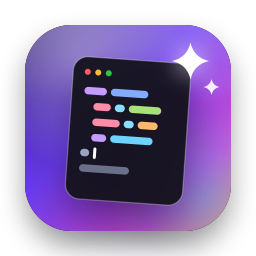
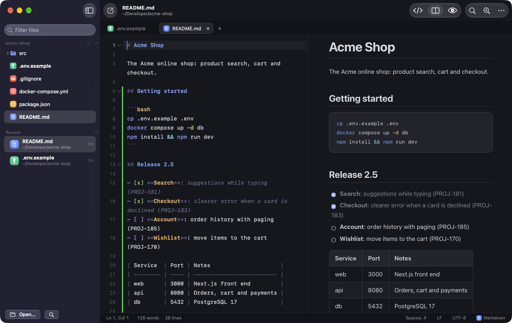

[](LICENSE)<br>[](https://github.com/fredy-mederos/vibe_notepad/releases/latest)

<br clear="left"/>

# Vibe Notepad ✨

A fast, native macOS text editor for the files you open every day: Markdown, `.env` files,
YAML/JSON configs, shell scripts and code. It uses SwiftUI and AppKit with Liquid Glass, and has
no third-party dependencies.

<p align="center">
  
</p>

## Download

**[Download VibeNotepad.dmg](https://github.com/fredy-mederos/vibe_notepad/releases/latest/download/VibeNotepad.dmg)**
(the latest release, for macOS 26 or later on Apple silicon and Intel), open it and drag Vibe Notepad
into Applications. Settings → General installs the `vibeNotePad` command. Every version is on the
[releases page](https://github.com/fredy-mederos/vibe_notepad/releases).

Vibe Notepad tells you when there's a new version: it asks GitHub when it opens and once a day, and
shows an alert once per new version. Vibe Notepad → Check for Updates… and Settings → General check
any time.

## Highlights

- **Opens any text file** with encoding detection (UTF-8/16/32 with or without BOM, Latin-1, Windows-1252,
  Shift-JIS, …). Line endings (LF/CRLF/CR) and the encoding are kept when saving. Binary files trigger a warning.
- **Recent and pinned files in the sidebar**, with fuzzy filtering, relative times, and missing-file detection.
  Pin the config files you edit all the time (`~/.zshrc`, `.env`, `~/.ssh/config`).
- **Sublime-style syntax highlighting** for 50+ languages, done incrementally: only the lines that change or scroll
  into view are re-colored, so large files stay smooth. `.env` files get keys, values, `${VAR}` interpolation,
  numbers, booleans and comments in distinct colors.
- **Markdown done right**: a styled source view (headings, emphasis, code spans, links, task boxes, tables and
  front matter), and fenced code blocks highlighted in their own language. There's also a **live preview**
  (Editor / Split / Preview) that supports GitHub-flavored tables, task lists, alerts and footnotes.
  Clicking a task checkbox in the preview ticks it in the file.
- **Open a folder as a project**: the sidebar shows its file tree, which follows changes on disk, and
  Quick Open searches every file in it (`git ls-files` in a repository, so ignored files stay out).
  Use File → Open Folder… (⇧⌘O), `vibeNotePad .`, or drop a folder on the window or the Dock icon.
- **Quick Open (⌘P)**: fuzzy search across open tabs, pinned and recent files, the project's files, and files
  near the current one. Type `name:42` to jump to a line.
- **Command Palette (⇧⌘P)** with editing tools: sort lines, change case, Base64 and URL encode/decode,
  format or minify JSON (key order is kept), convert indentation, insert a UUID, and more. Minified JSON
  (lines too long to highlight) shows a banner offering to format it.
- **Find & Replace** with regex (`$1` groups, `\n`), match case, whole word, a live match counter, and
  highlighted matches.
- **Code folding**: collapse `{ }` and `[ ]` sections in JSON and brace languages, indentation blocks in
  YAML and Python, and heading sections in Markdown. Use the gutter chevrons, click the `⋯` pill to expand,
  or use Fold / Unfold (⌥⌘[ / ⌥⌘]) and Fold All / Unfold All (⇧⌥⌘[ / ⇧⌥⌘]). Fold All on a JSON file leaves
  its top-level keys visible.
- **Git changes next to the line numbers**: added lines get a green bar, modified ones a blue bar, and a red
  wedge marks where lines were deleted, compared with the version staged in git and updated as you type.
  Commits, `git add` and checkouts are picked up when you come back to the app. Can be turned off in
  Settings → Editor.
- **Minimap**: a zoomed-out view of the file along the right edge, Sublime-style, with git changes marked;
  click or drag it to scroll. It steps aside when the editor is narrow or the sidebar is collapsed;
  View → Minimap turns it off.
- **Go to Line (⌃G)** and **Go to Symbol (⌘R)**: Markdown headings, functions and types, YAML keys,
  `.env` keys, INI sections and Makefile targets.
- **Editing comforts**: auto-indent, Markdown list continuation, soft tabs, bracket pairing and matching, toggle comment,
  move/duplicate/delete/join lines, word wrap, invisibles, line numbers, current-line highlight.
- **14 themes**: Vibe Night/Day, Mariana (Sublime's default), Monokai, Dracula, One Dark/Light, GitHub
  Light/Dark, Solarized, Nord, Catppuccin. The app follows the system appearance and lets you preview a
  theme live.
- **Hot exit** like Sublime: quit any time, and tabs and unsaved changes come back on the next launch.
- **Never loses track of files**: changes made by other apps reload automatically, and you're asked first when you have
  local edits. Saving writes in place, which keeps permissions, symlinks and Docker bind mounts intact.
- **Updates**: one request to GitHub's API for the latest release when the app opens (at most hourly) and once a day.
  A new version gets an alert, once, with Download and Release Notes; Settings → General keeps showing it until you
  update. Nothing is downloaded until you choose Download.

## Open files from anywhere

| How | Example |
| --- | --- |
| Finder | Right-click any text file or folder → **Open With → Vibe Notepad** |
| Terminal | `vibeNotePad README.md`, `vibeNotePad src/app.swift:42:7`, `vibeNotePad .`, `cat log.txt \| vibeNotePad -` |
| Deep link (scripts, agents) | `open "vibeNotePad://open?path=/abs/path/file.md&line=42&column=7"` |
| New buffer | `open "vibeNotePad://new?text=Hello&language=markdown"` |
| Drag & drop | Drop files or a folder onto the window or the Dock icon |

## Build and install from source

Requirements: macOS 26 or later, Xcode 26+ and [XcodeGen](https://github.com/yonaskolb/XcodeGen) (`brew install xcodegen`).

```bash
make install
```

This builds a Release version, copies **Vibe Notepad.app** to `/Applications`, registers it with Finder's
"Open With" menu, and installs the `vibeNotePad` command. The command can also be installed later from
**Settings → General**.

For development, open `VibeNotepad.xcodeproj` in Xcode, or use:

```bash
make run    # debug build + launch
make test   # VibeCore unit tests (syntax engine, lexers, Markdown, codecs, transforms, diff)
```

Every build is stamped with a build number (the number of commits), the commit and the build time,
shown in **Settings → General → About**.

Debug builds are called **Vibe Notepad Dev** and have their own bundle ID, preferences, data folder
and link scheme (`vibenotepad-dev://`), so they never take over links or "Open With" from the
installed app. They check for updates only when asked; `vibenotepad-dev://debug-updates` checks as
the installed app does at launch, and `?repository=owner/name` tries another repository's releases
(one with a newer version shows the update alert).

## Releasing

`make dmg` (`scripts/release.sh`) builds a Release for Apple silicon and Intel, signs it with a
Developer ID (with the hardened runtime), packs it into `build/VibeNotepad.dmg`, has Apple notarize
it and staples the ticket. It needs `APP_SIGN_IDENTITY` ("Developer ID Application: Your Name
(TEAMID)") and `NOTARY_KEYCHAIN_PROFILE` (a profile stored with `xcrun notarytool store-credentials`).

The `release-vibe-notepad` skill (`skills/`, linked for Claude Code and Codex) runs a whole release:
it picks and confirms the version (`scripts/version.sh`, which updates `project.yml` and regenerates
the project), builds the disk image, tags `vX.Y.Z` and publishes the GitHub release with notes from
`scripts/release-notes.sh`. Installed copies find it within a day.

## Keyboard shortcuts

| Action | Shortcut |
| --- | --- |
| New Tab (untitled file) | ⌘T or ⌘N |
| Open Folder | ⇧⌘O |
| Quick Open | ⌘P |
| Show / Hide Sidebar (tabs, toolbar buttons, status bar and minimap follow it) | ⌘B |
| Command Palette | ⇧⌘P |
| Find / Find & Replace | ⌘F / ⌥⌘F |
| Find Next / Previous | ⌘G / ⇧⌘G |
| Go to Line / Symbol | ⌃G / ⌘R |
| Toggle Comment | ⌘/ |
| Indent / Outdent | ⌘] / ⌘[ |
| Move Line Up / Down | ⌃⌘↑ / ⌃⌘↓ |
| Duplicate / Delete Line | ⇧⌘D / ⌃⇧K |
| Join Lines / Select Line | ⌘J / ⌘L |
| Markdown: Editor / Split / Preview | ⌥⌘1 / ⌥⌘2 / ⌥⌘3 (toggle: ⇧⌘V) |
| Fold / Unfold | ⌥⌘[ / ⌥⌘] |
| Fold All / Unfold All | ⇧⌥⌘[ / ⇧⌥⌘] |
| Format JSON | ⌥⌘J |
| Next / Previous Tab | ⌃Tab / ⌃⇧Tab, ⇧⌘] / ⇧⌘[ |
| Go to Tab 1…9 | ⌘1…⌘9 |
| Reopen Closed Tab | ⇧⌘T |
| Zoom In / Out / Reset | ⌘= / ⌘- / ⌘0 (or pinch) |

## Architecture

```
Packages/VibeCore          Platform-neutral core (builds for macOS and iOS)
  Syntax/                  Incremental line-state SyntaxEngine, language registry & detection, lexers
  Markdown/                GitHub-flavored Markdown → HTML renderer
  Theme/                   Color schemes
  Text/                    File codec (encodings, BOMs, line endings), editing transforms,
                           find engine, fuzzy matcher, symbol extraction, line diff (git gutter)
VibeNotepad                macOS app
  App/                     App entry, menus, AppDelegate (Finder/CLI/deep links), CLI installer, version info,
                           update checks
  Model/                   Workspace (tabs, recents, session/hot exit), project folder (tree, file index,
                           FSEvents watcher), documents, settings, file I/O
  Editor/                  TextKit 1 editor: NSTextView subclass, gutter, minimap, syntax styling, line height
  Preview/                 WKWebView Markdown preview (page scripts disabled, app talks via an isolated world)
  UI/                      SwiftUI: sidebar, tabs, status bar, find bar, palette, welcome, settings
```

The syntax engine stores the lexer state at the start of every line. After an edit it re-lexes from the
changed line and stops as soon as states converge, so typing costs one line of work whatever the file size.
The styler only paints lines that changed or became visible.

See [TODO.md](TODO.md) for ideas and the roadmap.

## Contributing

Vibe Notepad is a personal project, shared as is: clone it, fork it, make it your own. Issues (bug reports and
ideas) are welcome; pull requests aren't accepted. See [CONTRIBUTING.md](CONTRIBUTING.md).

## License

MIT. See [LICENSE](LICENSE).
